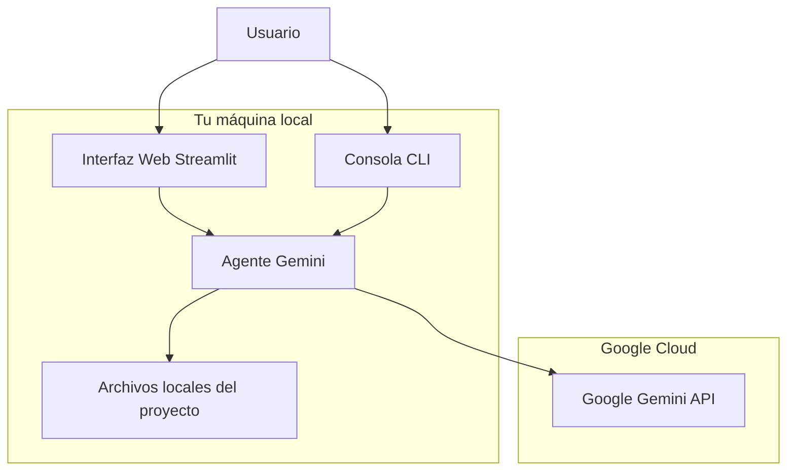
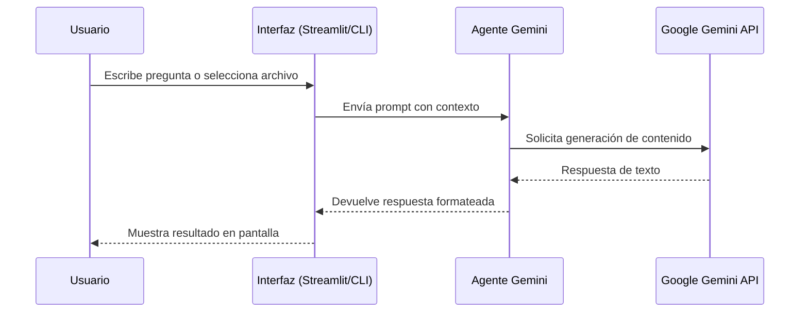

# Agente GProA Gemini

Agente de software basado en **Google Gemini** para auditar, explicar y responder preguntas sobre proyectos de desarrollo. Funciona completamente en tu máquina local con acceso a la API de Google Gemini.

---

## 📋 Tabla de contenidos

- [Descripción del proyecto](#descripción-del-proyecto)
- [Arquitectura](#arquitectura)
- [Estructura de carpetas](#estructura-de-carpetas)
- [Requisitos previos](#requisitos-previos)
- [Instalación y configuración](#instalación-y-configuración)
- [Uso del agente](#uso-del-agente)
- [Interfaz web (Streamlit)](#interfaz-web-streamlit)
- [Consola (CLI)](#consola-cli)
- [Seguridad y API Key](#seguridad-y-api-key)
- [Modelos disponibles](#modelos-disponibles)
- [Ejemplos de uso](#ejemplos-de-uso)
- [Solución de problemas](#solución-de-problemas)
- [Roadmap](#roadmap)

---

## 📖 Descripción del proyecto

**Agente GProA Gemini** es una herramienta de desarrollo basada en **Google Gemini** que permite:

1. **Chatear con la IA** sobre cualquier tema técnico relacionado con tus proyectos
2. **Auditar archivos de código** individuales para detectar problemas, sugerir mejoras y entender su funcionamiento
3. **Generar resúmenes ejecutivos** de proyectos completos

El agente no genera código por ti; solo analiza, explica y reporta. Es ideal para desarrolladores que necesitan una segunda opinión sobre su código o documentación automática.

---

## 🏗️ Arquitectura



### Flujo de datos



---

## 📁 Estructura de carpetas

```
Agente_Gemini/
├── agente_gemini.py          # Lógica principal del agente (funciones preguntar y auditar_proyecto)
├── ui/
│   └── streamlit_app.py      # Interfaz web con Streamlit (3 pestañas)
├── start-agent.ps1           # Script de inicio: crea .venv, instala dependencias, inicia app
├── requirements.txt          # Dependencias de Python
├── .env.example              # Plantilla para archivo .env (NO compartir)
├── .env                      # TU archivo privado con GOOGLE_API_KEY (NO subir a Git)
├── .gitignore                # Archivos ignorados por Git
├── README.md                 # Este archivo
└── diagnosticar_modelos.py   # Script temporal para listar modelos disponibles (puede borrarse)
```

---

## ⚙️ Requisitos previos

| Requisito | Versión mínima | Notas |
|-----------|---------------|-------|
| Python | 3.9+ | Necesario para crear el entorno virtual |
| pip | Incluido con Python | Para instalar dependencias |
| Conexión a internet | Sí | Requerido para llamar a la API de Google Gemini |
| API Key de Google Gemini | Sí | Obtener en [Google AI Studio](https://makersuite.google.com/app/apikey) |

---

## 🚀 Instalación y configuración

### Paso 1: Obtener tu API Key de Google

1. Ve a [Google AI Studio](https://makersuite.google.com/app/apikey)
2. Inicia sesión con tu cuenta de Google
3. Crea una nueva API Key
4. **Copia la clave** (la necesitarás en el siguiente paso)

### Paso 2: Clonar o usar este repositorio

Si ya tienes la carpeta en tu máquina, omite este paso. Si no:

```bash
git clone https://github.com/gproatechnology/GProA_Agente_Gemini.git
cd GProA_Agente_Gemini
```

### Paso 3: Configurar tu archivo `.env`

El archivo `.env.example` contiene la plantilla. Crea tu propio archivo `.env`:

```powershell
# Copiar la plantilla
Copy-Item .env.example .env

# Editar el archivo .env y pegar tu API Key real
notepad .env
```

El contenido de `.env` debe ser:

```
GOOGLE_API_KEY=tu_api_key_real_de_google_aquí
```

**⚠️ Importante:** Nunca subas el archivo `.env` a GitHub. Está en `.gitignore` por seguridad.

### Paso 4: Ejecutar el script de inicio

```powershell
.\start-agent.ps1
```

Este script:
1. Crea el entorno virtual (`.venv`) si no existe
2. Activa el entorno virtual
3. Instala todas las dependencias (`google-generativeai`, `python-dotenv`, `streamlit`)
4. Te pregunta si quieres abrir la interfaz web o la consola

### Paso 5: Elegir cómo usar el agente

| Opción | Comando | Descripción |
|--------|---------|-------------|
| Interfaz web | Opción 1 en `start-agent.ps1` | Abre Streamlit en `http://localhost:8501` |
| Consola (CLI) | Opción 2 en `start-agent.ps1` | Ejecuta `agente_gemini.py` en la terminal |

---

## 💻 Uso del agente

### Opción A: Interfaz web (Streamlit)

El script `start-agent.ps1` te ofrece iniciar la interfaz web. Se abrirá en tu navegador en:

```
http://localhost:8501
```

La interfaz tiene **3 pestañas**:

| Pestaña | Qué hace |
|---------|----------|
| **Chat con Gemini** | Escribe cualquier pregunta técnica y obtén respuesta en tiempo real |
| **Auditar archivo de código** | Indica la ruta de un archivo y pídele a Gemini que lo analice |
| **Auditar proyecto (resumen)** | Pide un resumen ejecutivo de todo un proyecto |

#### Ejemplo de uso en el chat:

```
Pregunta: ¿Cómo funciona el motor KNN de GlucAI?

Respuesta: El motor KNN de GlucAI clasifica perfiles de química sanguínea
en tres categorías: Normal, Prediabetes o Riesgo. Utiliza los 33
biomarcadores definidos, normaliza con z-score, calcula distancias
euclídeas ponderadas y vota por la clase más cercana entre k=5 vecinos.
```

#### Ejemplo de uso en auditoría de archivo:

```
Ruta del proyecto: C:\Users\X1\OneDrive\Documentos\Python_VS Code\GProA
Nombre del archivo: src/js/knn/clasificador.js

Resultado: El archivo implementa un clasificador KNN...
```

### Opción B: Consola (CLI)

```powershell
python agente_gemini.py
```

```
=== Agente GProA Gemini ===
Escribe tu pregunta o 'auditar <archivo>' para analizar un archivo.
Escribe 'salir' para terminar.

Tú: ¿Qué hace el motor KNN de GlucAI?

Pensando...

El motor KNN de GlucAI es un clasificador...
----------------------------------------
Tú: salir
```

---

## 🔒 Seguridad y API Key

### Reglas de oro

| Regla | Por qué |
|-------|---------|
| Nunca subas `.env` a GitHub | Contiene tu API Key privada |
| Nunca compartas tu API Key | Cualquiera podría usarla y consumir tu cuota |
| Usa `.env.example` para documentar | Solo placeholders, sin valores reales |
| Rotar la clave si se filtra | Ve a Google AI Studio y genera una nueva |

### Verificar que `.env` no se subió

```powershell
git status
```

Deberías ver que `.env` no aparece como archivo rastreado. Si aparece, agrégalo a `.git-ignore` inmediatamente:

```powershell
echo .env >> .gitignore
git rm --cached .env
```

---

## 🧠 Modelos disponibles

Tu API Key tiene acceso a los siguientes modelos (según tu cuenta de Google):

| Modelo | Uso recomendado |
|--------|-----------------|
| `models/gemini-2.5-flash` | General, rápido y equilibrado (predeterminado) |
| `models/gemini-2.5-flash-lite` | Más rápido, para tareas simples |
| `models/gemini-2.5-pro` | Más capacidad, para tareas complejas |
| `models/gemini-flash-latest` | Última versión estable de Flash |
| `models/gemini-pro-latest` | Última versión estable de Pro |

Para cambiar el modelo, edita la variable `MODELO_PREDETERMINADO` en `agente_gemini.py` o selecciona otro en el selectbox de la interfaz web.

Para ver todos los modelos disponibles para tu API Key, ejecuta:

```powershell
python diagnosticar_modelos.py
```

---

## 💡 Ejemplos de uso

### Analizar un archivo específico

```
Tú: auditar Pagina_web/src/js/modules/noticias-ia.js

Agente: El archivo implementa el módulo de noticias para la página web GProA...
```

### Obtener un resumen de un proyecto

```
Tú: auditar Sistema_Humpty (sin archivo, solo carpeta)

Agente: Sistema_Humpty es un sistema de punto de venta distribuidor...
```

### Pregunta general

```
Tú: ¿Cuáles son las vulnerabilidades más comunes en código JavaScript?

Agente: Las vulnerabilidades más comunes en JavaScript incluyen XSS...
```

---

## 🐛 Solución de problemas

| Problema | Posible causa | Solución |
|----------|---------------|----------|
| `403 Forbidden` | API Key inválida o sin acceso | Verifica tu API Key en Google AI Studio |
| `404 NotFound` | Modelo no existe o no disponible | Usa `models/gemini-2.5-flash` o ejecuta `diagnosticar_modelos.py` |
| `429 TooManyRequests` | Límite de cuota alcanzado | Espera unos minutos o actualiza tu plan en Google AI Studio |
| `ModuleNotFoundError: No module named 'google.generativeai'` | Dependencias no instaladas | Ejecuta `.\start-agent.ps1` de nuevo |
| `streamlit: comando no encontrado` | Streamlit no instalado | Ejecuta `pip install -r requirements.txt` |
| El navegador no se abre automáticamente | Streamlit no abre navegador por defecto | Ve manualmente a `http://localhost:8501` |

---

## 🗺️ Roadmap

| Versión | Funcionalidad planeada |
|---------|----------------------|
| v1.0.0 | Agente base con chat y auditoría de archivos (actual) |
| v1.1.0 | Exportar reportes de auditoría a PDF/Markdown |
| v1.2.0 | Soporte para múltiples proyectos simultáneos |
| v1.3.0 | Historial de conversaciones persistente |
| v2.0.0 | Integración con repositorios Git para auditoría automática |

---

## 📄 Licencia

MIT License — GProA Technology

---

*Última actualización: Noviembre 2026*
